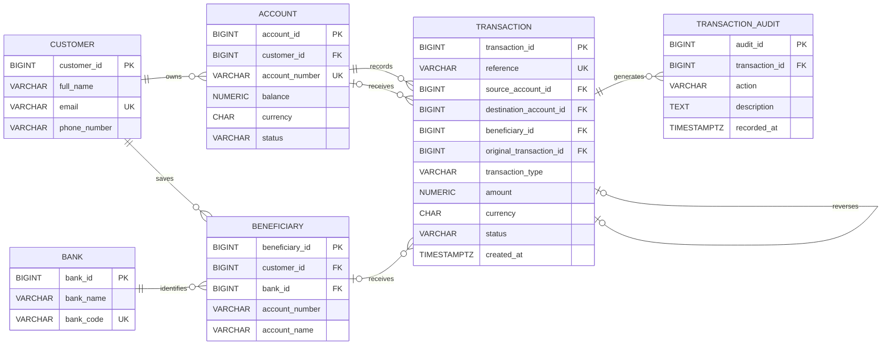

# PurpleBank ER Diagram

## Entity-Relationship Diagram

The Entity-Relationship (ER) diagram represents the proposed relational database structure for PurpleBank, a fictional Nigerian digital bank. It illustrates six core entities, their attributes, primary and foreign keys, and the relationships required to support customer accounts, NGN transactions, internal and simulated interbank transfers, beneficiaries, and transaction auditing.

## Explanation of Keys

**Primary Key (PK):** A field that uniquely identifies each record in a table. For example, `customer_id` uniquely identifies each PurpleBank customer.

**Foreign Key (FK):** A field that references a record in another table, establishing a relationship. For example, `customer_id` in the Account table links each account to its registered customer.

**Unique Key (UK):** A constraint that prevents duplicate values in a field. For example, each PurpleBank account must have a unique `account_number`.

## Relationship Cardinality

The diagram uses Crow's Foot notation:

- `||` means exactly one.
- `o|` means zero or one.
- `o{` means zero or many.

For example, `CUSTOMER ||--o{ ACCOUNT` means a customer may own zero or many accounts, while every account belongs to exactly one customer.

The Transaction table also has a self-referencing relationship, allowing a reversal transaction to reference its original transaction.

## Optional Fields and Additional Constraints

The Transaction table contains optional foreign keys depending on transaction type:

- `destination_account_id` is populated for internal transfers and is otherwise null.
- `beneficiary_id` is populated for interbank transfers and is otherwise null.
- `original_transaction_id` is populated for reversals and is otherwise null.

Every transaction references an existing PurpleBank account through `source_account_id`, representing the account involved in the operation.

The following rules require additional database constraints or transaction logic:

1. Transaction amounts must be positive, and all accounts and transactions must use NGN.
2. Only active accounts may initiate withdrawals and outgoing transfers.
3. Concurrent withdrawals and transfers must not cause negative available balances.
4. Transaction types determine which optional foreign keys are required.
5. Transaction statuses must be restricted to pending, successful, failed, or reversed.
6. A successful transaction may be reversed only once. The original record remains available for auditing.

The database design uses PostgreSQL-compatible data types, with detailed field lengths and numeric precision documented in the Portfolio 1 design file. The diagram describes the proposed structure and does not represent an executed database implementation.