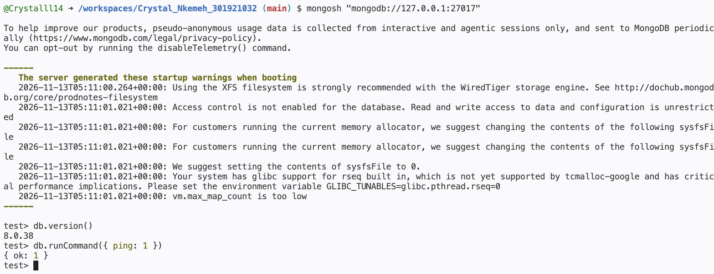

# PurpleBank MongoDB Setup

## Overview

MongoDB Community Server was installed within the existing Ubuntu GitHub Codespace for PurpleBank's NoSQL database portfolio.

MongoDB will be used to demonstrate document-based storage of fictional banking activity and transaction events, while PostgreSQL remains the primary relational database for customer accounts and financial transactions.

## Installation and Configuration

MongoDB was installed using the official MongoDB Ubuntu package repository.

The database server stores its files in `/workspaces/mongodb-data`, outside the GitHub repository, and accepts local connections through `127.0.0.1` on port `27017`.

Public port forwarding is disabled.

## Starting MongoDB

The server can be started using:

```bash
mongod --dbpath /workspaces/mongodb-data --logpath /workspaces/mongodb-data/mongod.log --logappend --bind_ip 127.0.0.1 --fork
```

The MongoDB shell can be opened using:

```bash
mongosh "mongodb://127.0.0.1:27017"
```

## Connection Verification

**MongoDB version:** [Enter actual version]

The connection was tested using:

```javascript
db.version()
db.runCommand({ ping: 1 })
```

The successful `ping` command returned `{ ok: 1 }`, confirming that the MongoDB server was accessible.

## Evidence



## Reference

[MongoDB Community Edition Installation Guide for Ubuntu](https://www.mongodb.com/docs/v8.0/tutorial/install-mongodb-on-ubuntu/)